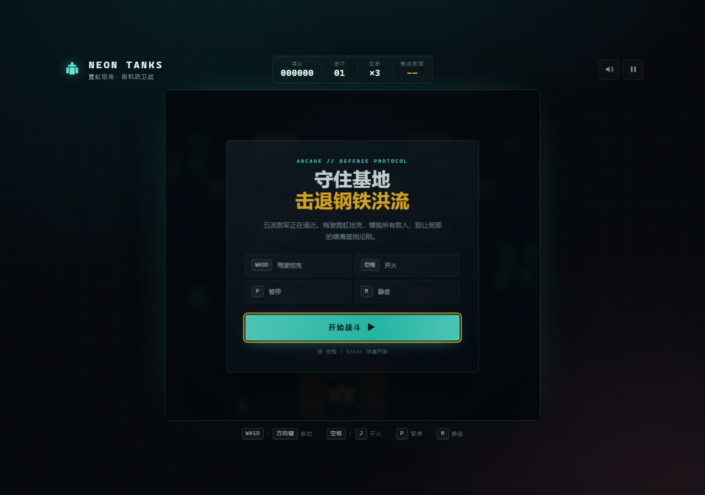

# 霓虹坦克 · NEON TANKS

一款使用原生 HTML5 Canvas 制作的复古街机坦克大战。无框架、无依赖、无需构建，打开网页即可开战。



## 玩法

驾驶坦克守住底部的雄鹰基地，消灭全部五波敌军。砖墙可以被炮弹击穿，钢墙无法破坏，水面会阻挡坦克，树林可以藏住行踪。

击毁敌人有概率掉落强化道具：

| 道具 | 效果 |
| --- | --- |
| **S · 护盾** | 8 秒内免疫伤害 |
| **» · 连发** | 9 秒内提高射速并增加弹容量 |
| **+ · 生命** | 增加一辆备用坦克 |
| **F · 冻结** | 冻结场上全部敌人 6 秒 |

## 特性

- 5 波递增难度，4 种敌方坦克（普通、侦察、炮手、重装）
- 程序化生成的对称战场，砖墙、钢墙、水面、树林四种地形
- 可破坏掩体、基地防守、道具掉落、连杀计分
- 粒子爆炸、屏幕震动、扫描线霓虹视觉
- 使用 Web Audio API 实时合成音效，无外部音频文件
- 支持键盘与手机 / 平板触屏操作，自适应横竖屏
- 纯静态站点，可直接部署到 GitHub Pages

## 操作

| 操作 | 键盘 |
| --- | --- |
| 移动 | `W A S D` / 方向键 |
| 开火 | `空格` / `J`（可按住连发） |
| 暂停 | `P` / `Esc` |
| 静音 | `M` |

触屏设备会自动显示左下方向键和右下 `FIRE` 按钮。

## 本地运行

直接双击 `index.html`，或在项目目录启动一个静态服务器：

```bash
python -m http.server 8000
```

然后访问 <http://localhost:8000>。

## 项目结构

```text
.
├── index.html      # 页面、HUD、菜单与触屏控件
├── style.css       # 霓虹街机风格与响应式布局
├── game.js         # 游戏循环、地图、AI、物理、渲染与音效
├── screenshots/    # README 截图
└── README.md
```

## 技术栈

- HTML5 Canvas 2D
- 原生 JavaScript（无框架）
- Web Audio API
- CSS Grid / Flexbox / 响应式媒体查询

## 许可

[MIT](LICENSE)
